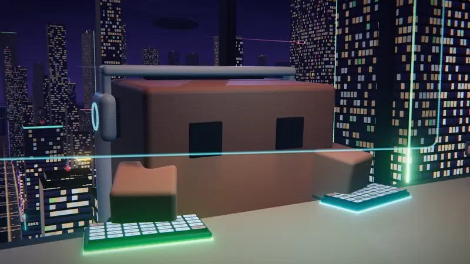
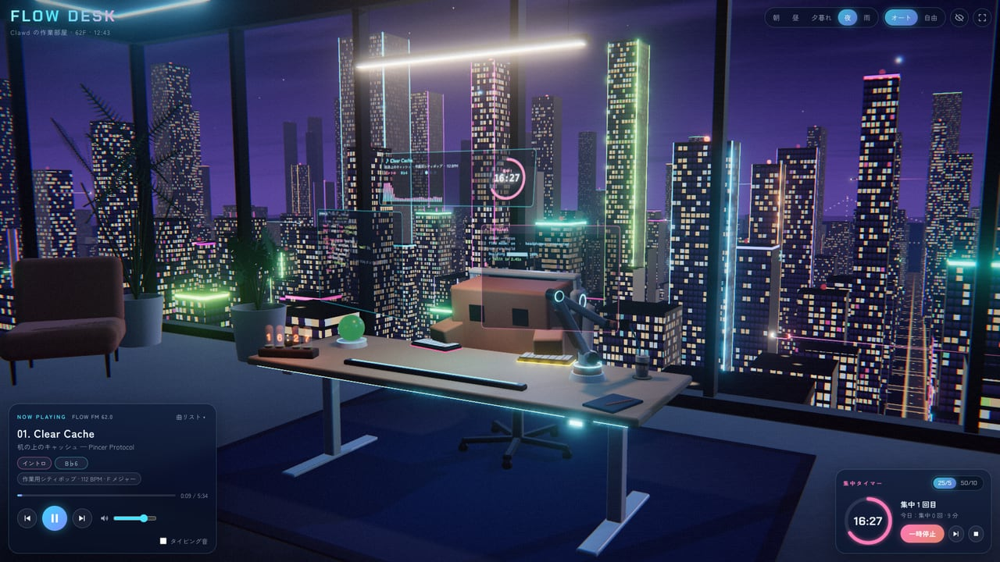
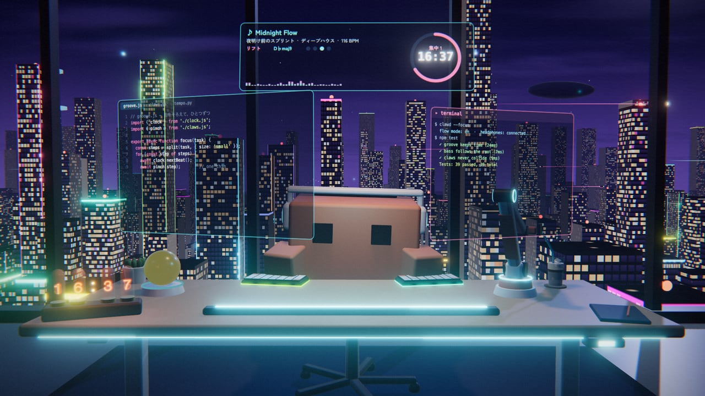
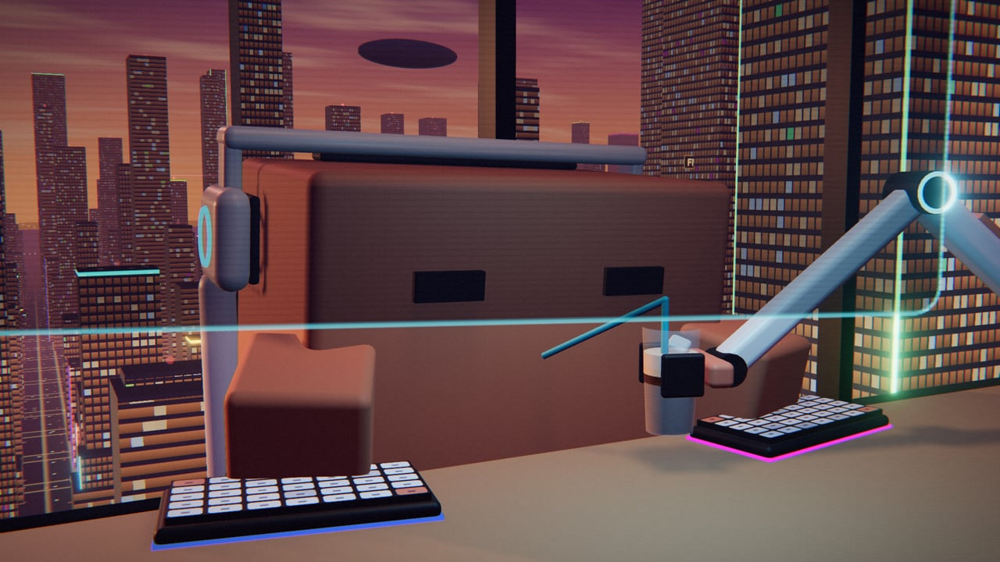
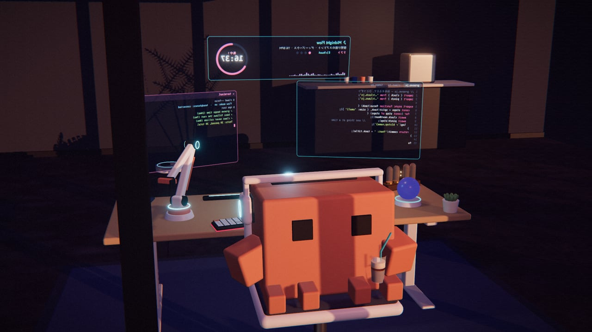
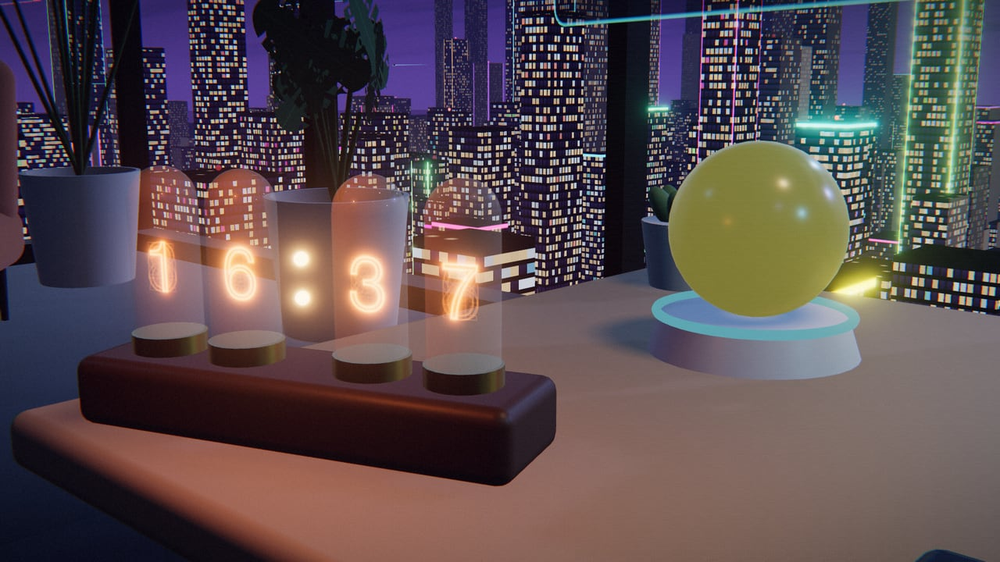
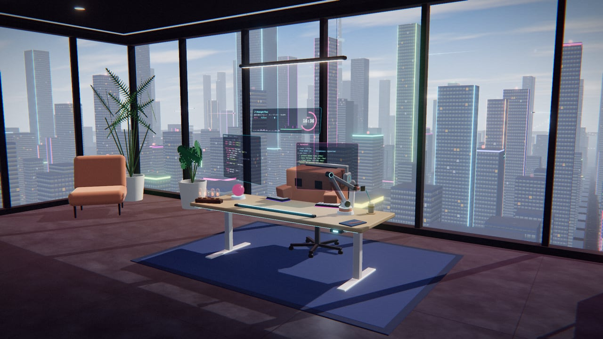
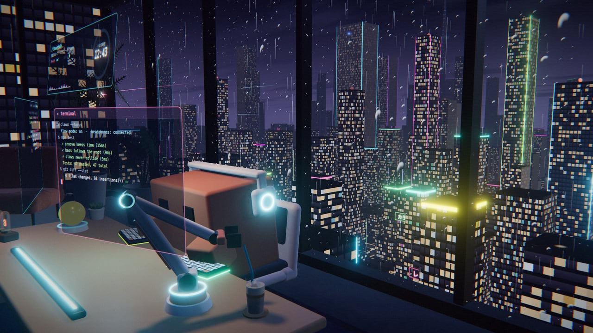
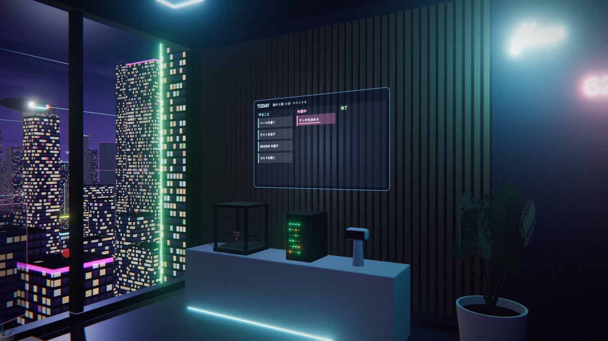

# Flow Desk — Clawd の作業部屋

近未来の高層ビル 62 階の作業部屋で、Clawd が作業用の曲を聴きながら仕事をする様子を眺める、集中タイマー付きのブラウザ 3D アプリです。

[](https://tanuu5.github.io/clawd-flow-desk/)
[](https://www.anthropic.com/claude)
[](./LICENSE)

<p align="center">
  
</p>

<p align="center"><b><a href="https://tanuu5.github.io/clawd-flow-desk/">▶ ブラウザで開く</a></b>（インストール不要・音が出ます）</p>

**Claude Code × Claude Opus 5.5（XHIGH）** で作りました。

流れる曲は、集中を助けるとされた音楽の特徴（[Orpella ほか, 2025](https://doi.org/10.1371/journal.pone.0316047)）に合わせて、その場で自動作曲し、Web Audio で合成しています（音声ファイルは使っていません）。集中タイマー（25 分の集中と 5 分の休憩）を使うと、休憩のあいだは曲がゆったりしたものに変わり、Clawd も椅子ごと振り返って窓の外を眺めます。部屋も街も Clawd も、すべてコードで作っています。前作は、同じビルのラウンジでくつろぐ [City Pop Lounge](https://github.com/tanuu5/clawd-city-pop-lounge) です。

## スクリーンショット

<table>
  <tr>
    <td width="50%"><br><sub>夜の作業部屋。左下が再生カード、右下が集中タイマーです。</sub></td>
    <td width="50%"><br><sub>机に浮かぶホログラムの画面。Clawd がキーを打つと、コードが少しずつ進みます。</sub></td>
  </tr>
  <tr>
    <td width="50%"><br><sub>手がふさがっているので、ロボットアームがアイスコーヒーを口元まで運んでくれます。</sub></td>
    <td width="50%"><br><sub>休憩では、椅子を引いて振り返り、窓の外を眺めながらひと休み（窓の外から）。</sub></td>
  </tr>
  <tr>
    <td width="50%"><br><sub>ニキシー管のタイマー。集中の残り時間（タイマーを使っていないときは時刻）を表示します。</sub></td>
    <td width="50%"><br><sub>昼。時間帯は朝・昼・夕暮れ・夜・雨の夜の 5 つです。</sub></td>
  </tr>
  <tr>
    <td width="50%"><br><sub>雨の夜。窓ガラスを雨粒が流れ、雨音も鳴ります。</sub></td>
    <td width="50%"><br><sub>壁のタスクボードと 3D プリンタ。集中を 1 回終えるごとに、小さな Clawd が 1 体できあがります。</sub></td>
  </tr>
</table>

画像と動画は、すべて実際の画面です。

## 使い方

「曲を流して作業する」を押すと曲が始まり、Clawd が仕事をはじめます。「＋ 集中タイマーも使う」なら、集中タイマーも同時に動きます。

| 操作 | 動作 |
|---|---|
| Space | 再生／一時停止 |
| ← → | 前の曲／次の曲 |
| T | 集中タイマーをはじめる／一時停止 |
| 1 2 3 4 5 | 朝／昼／夕暮れ／夜／雨の夜 |
| C | カメラ（オート／自由。自由ではドラッグで見回せます） |
| H | UI を隠す |
| M | 消音 |
| Clawd をクリック | 跳ねて喜びます |

- **集中タイマー**：25 分の集中と 5 分の休憩をくり返し、4 回ごとに 15 分の長い休憩が入ります（50 分＋10 分にも切り替えられます）。区切りで短い合図の音が鳴ります。タブを裏に回していても時間は進みます。
- **タイピング音**：再生カードの「タイピング音」をオンにすると、Clawd がキーを打つ音が鳴ります（最初はオフ）。
- 曲と曲は途切れずにつながり、8 曲目のあとも新しい曲を作り続けます。

## 作業用の曲について

Orpella ほか（2025, PLOS ONE）は、集中を助けるとうたう音楽を聴きながら課題をする実験で、「work flow」と呼ばれる曲だけが、気分を上げ、反応を速くしたと報告しています。その曲の特徴に合わせて作りました。

| 論文の work flow 音楽の特徴 | この作品の曲 |
|---|---|
| 中くらいの速さのテンポ（平均 119 BPM）、拍がはっきり、リズムは単純 | 112〜122 BPM。キックは毎拍か、1・3 拍が中心。盛り上がりを抜く区間でもハットで拍を刻む |
| シンプルな調性、メロディと和音の変化が少ない | 1 曲を 1 つのコード進行のくり返しで通す。キーの外の音は使わない（全曲 0%）。メロディは 5 音音階の短いフレーズのくり返し |
| 約 6000Hz 以下に広く分布する音（スペクトル重心 約 2.3kHz） | ハットやベルの高い音を抑え、6kHz より上をなだらかに落とす（6kHz より上のエネルギーは約 1%、重心は約 1.3〜2.7kHz） |
| 適度なダイナミクス（はっきりした立ち上がり、適度な音の数） | 拍ごとの音が中心。ブレイクで音量が下がるのは 2〜3dB 前後 |
| 歌がなく、1 曲が長い | 歌なし。1 曲 5〜6 分で、曲と曲は途切れずにつながる |

- 数値は、曲をオフラインで書き出して測ったものです（`dev/audio-test.html`）。
- 論文の実験は 10 分ほどの短いもので、測ったのは気分と反応の速さです。曲の提供元が研究資金を出しています（論文に記載）。この作品も、集中できることを約束するものではありません。

## 曲について

- スタイルは、ディープハウス、シンセウェーブ、フューチャーファンク、作業用シティポップの 4 つ。休憩のあいだはラウンジ（遅め・やわらかめ）に変わります。
- 構成は、イントロ → グルーヴ → メイン → リフト → ブレイク … → アウトロ。楽器を足したり引いたりして、少しずつ変えていきます。
- 音色は、FM エレピ、オルガンのスタブ、プラック、シンセベース、Karplus-Strong のカッティングギター、パッドなど。キックに合わせて伴奏が沈む（サイドチェイン風）ようにしています。
- 曲名とアーティスト名（Pincer Protocol）は架空のものです。

## 制作について

企画・ディレクション：**たぬ**　／　開発：**Claude Code（Claude Opus 5.5・推論レベル XHIGH）**

作曲エンジン、音色の合成、部屋と Clawd とロボットアームの 3D、集中タイマー、UI まで、Claude Code が設計から実装まで進めました。論文の要点の整理はサブエージェント（Claude Sonnet）に任せました。Claude は音を聴けないので、曲はオフラインで書き出して、テンポ・キーの外の音の割合・スペクトルの特徴・音量・音割れを数値で確かめ、聴いた感想はたぬが伝えています。見た目は、ヘッドレス Chrome（実 GPU）で撮った画面を見ながら直しています（椅子が机に当たる、ドリンクが宙を浮く、などはたぬの指摘で直しました）。

## 更新履歴

- **2026-10-12**：公開

## 開発

```bash
npm install
npm run dev      # http://127.0.0.1:5184/
npm run build    # dist/ に書き出し
```

- `?dev` を付ける（開発サーバーでは常に）と、確認用のフック `window.__dev` が使えます（`__dev.goto('night')`、`__dev.goto('clawd')`、`__dev.skipAhead(秒)` など）。`?clean=1` で UI を隠します。
- `dev/audio-test.html`（開発サーバーのみ）で、曲の一部をオフラインで書き出して、音量とスペクトルの特徴を測れます（`sectionFeatures({ track: 0 })` など）。
- `?video=60` は動画モードです。UI を出さずに自動で再生し、集中 25 分＋休憩 5 分を 2 回まわして、時間帯を朝 → 昼 → 夕暮れ → 夜 → 雨の夜と移します。タイマーと曲名は画面に重ねます。
- `caffeinate -dims node dev/record-video.mjs --minutes 60` で、動画モードをヘッドレス Chrome で開き、映像と音を実時間で録画します（開発サーバーを起動しておく。`shots/video/` に MP4 とチャプター一覧ができます）。

| ファイル | 中身 |
|---|---|
| `src/audio/composer.js` | シードから曲を組み立てる（構成・コードループ・フック・各楽器のパターン） |
| `src/audio/instruments.js` | 楽器の合成（FM エレピ、オルガン、プラック、ベース、ギター、ドラムなど） |
| `src/audio/engine.js` | 先読みスケジューラ、曲の継ぎ目なしの再生と休憩曲へのクロスフェード、ミキサー |
| `src/focus.js` | 集中タイマー |
| `src/scene/clawd.js` | Clawd のモデルと動き、ドリンクの受け渡し |
| `src/scene/robotArm.js` | ロボットアーム（2 関節の逆運動学） |
| `src/scene/room.js` / `city.js` | 部屋と、窓の外の街・空・雨 |
| `src/scene/screens.js` | ホログラムの画面とタスクボードの中身 |
| `src/scene/director.js` | カメラのショットと切り替え |

## GitHub Pages で公開する

`main` に push すると、GitHub Actions（`.github/workflows/deploy.yml`）がビルドして GitHub Pages に公開します。初回だけ、リポジトリの Settings → Pages → Source を「GitHub Actions」にします。

## クレジット・ライセンス

- コード：MIT License（[LICENSE](LICENSE)）© 2026 たぬ
- 3D 描画：[three.js](https://threejs.org/)（MIT License）
- フォント：[Chakra Petch](https://fonts.google.com/specimen/Chakra+Petch)、[Zen Kaku Gothic New](https://fonts.google.com/specimen/Zen+Kaku+Gothic+New)（どちらも SIL Open Font License 1.1）。Google Fonts から読み込んでいます（リポジトリには含めていません）。
- 参考にした論文：Orpella, J., Bowling, D. L., Tomaino, C., & Ripollés, P. (2025). Effects of music advertised to support focus on mood and processing speed. *PLOS ONE*, 20(2), e0316047.
- 曲・効果音・画像は、すべてこのリポジトリのコードがその場で生成しています。既存の曲のメロディや音源は使っていません。
- **Clawd について**：Clawd は Anthropic の Claude Code のマスコットです。この作品の Clawd は、その姿をもとにした二次創作（ファンアート）で、Anthropic の公式のものではなく、Anthropic とは関係ありません。キャラクターの権利は Anthropic にあり、MIT License の対象外です。
- MIT License の対象は、このリポジトリのコードと文章です。「Claude」「Clawd」の名前や商標の使用を許諾するものではありません。
